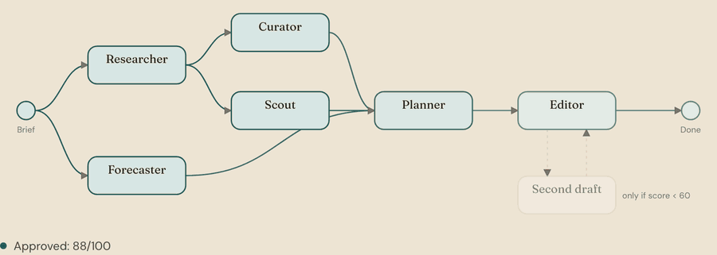

# 🌍 Multi-Agent Travel Orchestrator

An AI travel planner where six agents, orchestrated with **LangGraph** and powered by **Google Gemini**, turn a one-line brief into a checked, costed, day-by-day trip. Runs on a single free **Google AI Studio** key.




## How it works

Research and weather run in parallel, then activities and bookings, then the planner writes the itinerary and the validator scores it. A plan scoring below 60 goes back for one revision, and the better version is kept. Progress streams to the UI over Server-Sent Events as a live agent graph.

| Agent | Produces |
|-------|----------|
| Research | Overview, neighbourhoods, etiquette, safety, transport, with sources |
| Weather | Per-day forecast (or typical conditions) and a packing list |
| Activity | 12–18 named activities with cost and duration |
| Booking | Flight and hotel estimates with search links |
| Itinerary | Day-by-day plan within the remaining budget |
| Validator | Scores 6 categories; checks budget, travel time between stops and meals in code |

Research, weather, activity and booking use **Google Search grounding**, so plans name real places and cite sources.

## Highlights

- **Reliable numbers**: models estimate prices, code does the arithmetic, so totals and "over budget" are always consistent. 160+ currencies with live exchange rates.
- **Free-tier friendly**: an 8-model Gemini fallback chain skips models that are out of quota until they reset; repeat requests are cached.
- **Refine anything**: chat to change the plan, re-plan a single day ("rain on day 3"), or drag and drop stops.
- **Multi-city trips**, interactive map, budget charts, calendar and PDF export.
- **Plan together**: Google sign-in (optional), invite links, votes and comments.
- **Installable PWA**: saved trips open offline.
- **Measured quality**: an eval harness runs 16 fixed trips with deterministic checks and an LLM judge; results are charted on `/evals`.

## Quick start

You need Python 3.11+, Node.js 18.18+ and a free [Gemini API key](https://aistudio.google.com/apikey).

```bash
# Backend: http://localhost:8000 (API docs at /docs)
cd orchestrator_backend
python -m venv .venv && source .venv/bin/activate
pip install -r requirements.txt
cp .env.example .env            # set GOOGLE_API_KEY
python main.py

# Frontend: http://localhost:3000
cd frontend
npm install
cp .env.example .env.local
npm run dev
```

## Configuration

Set these in `orchestrator_backend/.env`. Every other option is described in [`.env.example`](orchestrator_backend/.env.example).

| Variable | Notes |
|----------|-------|
| `GOOGLE_API_KEY` | **Required.** |
| `MONGODB_URI` | Optional. Without it, plans are kept in memory and lost on restart. A free MongoDB Atlas cluster works. |
| `GEMINI_MODEL` / `GEMINI_LIGHT_MODEL` | The model that writes itineraries, and the cheaper one for the other agents. |
| `GOOGLE_CLIENT_ID` | Optional. Turns on Google sign-in. |
| `TRAVELPAYOUTS_TOKEN` | Optional, free. Shows recent real fares next to flight estimates. |

## Evaluation

```bash
cd orchestrator_backend
python -m evals.run_evals --limit 3    # quick run; drop --limit for all 16 trips
python -m evals.run_evals --no-revision --compare evals/results/<run>.json   # what the revision loop adds
```

Each plan gets 11 deterministic checks (dates, budget, meals, pace, repeats, mapped stops, multi-city routing), an LLM-as-judge score, and cost and latency from the agent trace.

## Deployment

- **Backend on Render**: New → Blueprint with this repo (uses `render.yaml`). Set `GOOGLE_API_KEY`, `CORS_ORIGINS` (your Vercel URL) and `MONGODB_URI`.
- **Frontend on Vercel**: import the repo with root directory `frontend`, and set `NEXT_PUBLIC_API_URL` to your Render URL.
- **CI** runs the offline backend tests and the frontend typecheck, lint and build on every push.

## Testing

```bash
cd orchestrator_backend && pip install -r requirements-dev.txt && pytest
cd frontend && npm run typecheck && npm run lint && npm run build
```

Backend tests run fully offline against a fake LLM.

## Limitations

- Hotel and flight prices are estimates, not live fares.
- AI-generated plans can contain mistakes; verify prices, opening hours and advisories before booking.

## License

MIT, see [LICENSE](LICENSE).
